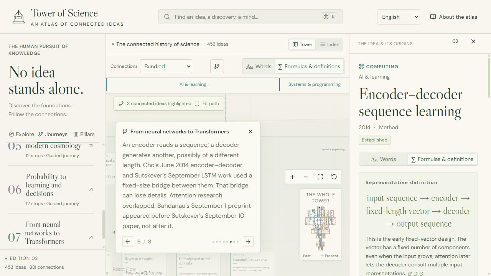
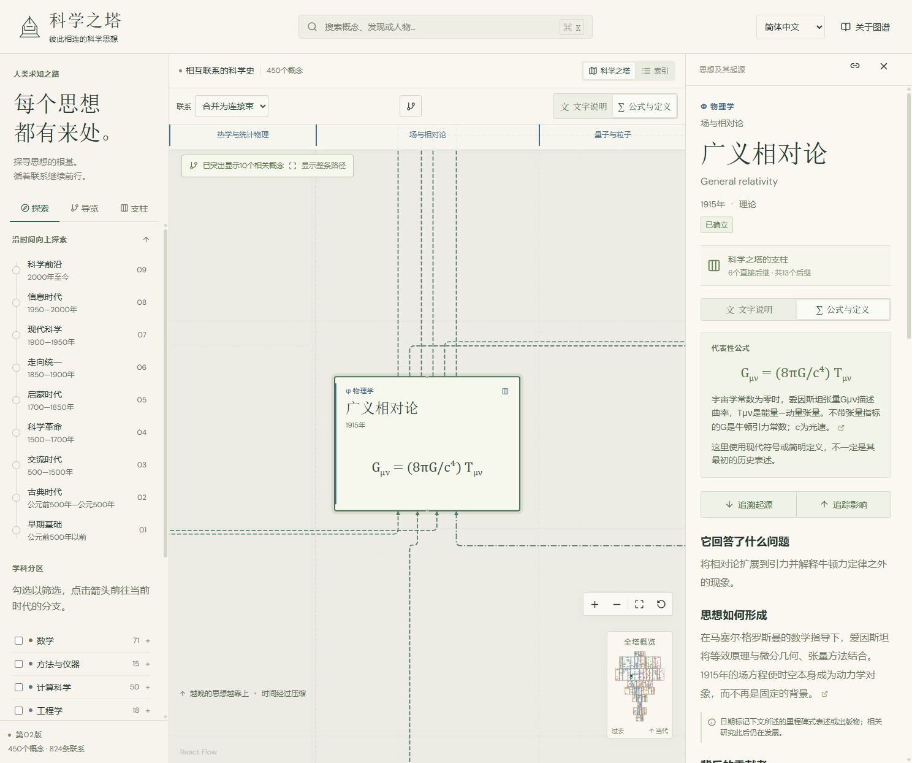
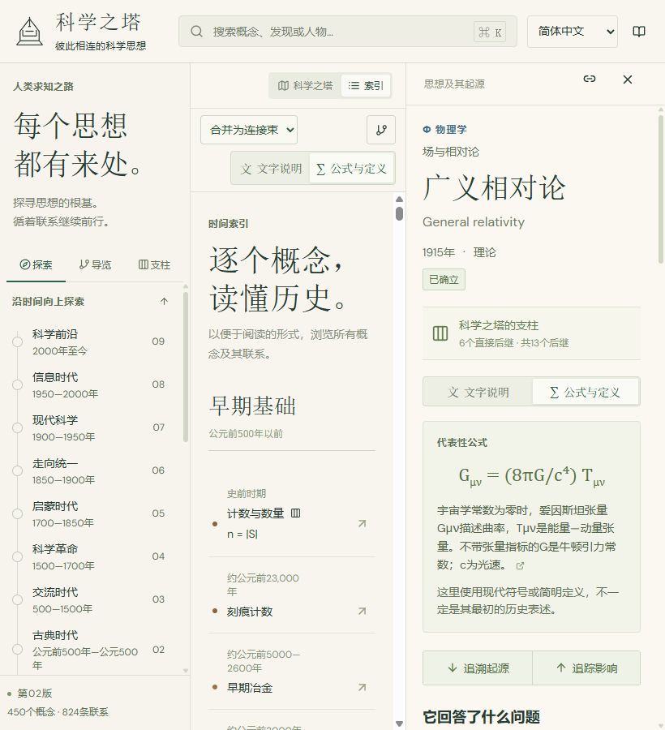
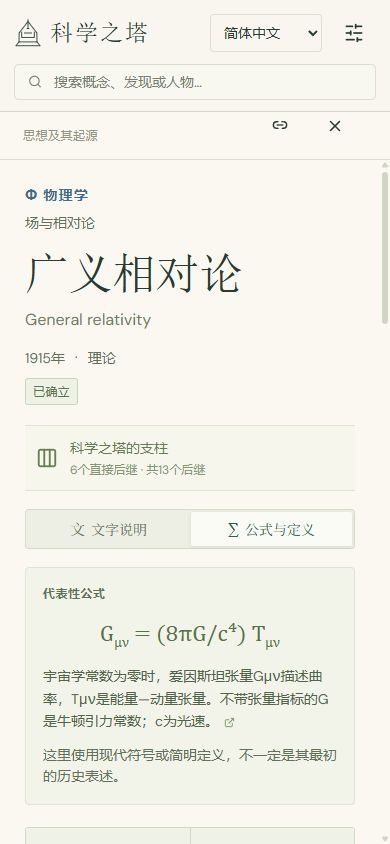

# Edition 2 verification

## Version 2.1.1 interface checks · 2026-11-04

Sidebar lag reproduced in desktop Chrome 156 on Windows using the NVIDIA RTX 4090 through Direct3D 11. Both production builds ran at 1440 × 850 with GPU compositing enabled. Each trace started after fitting the entire tower and letting the camera settle. The second scene selected diffusion generative models, traced their ancestors, and enabled **All connections**. The trackpad case used short bursts of fractional wheel input.

| Settled scene | Sidebar input | 2.1.0 p95 frame interval | 2.1.1 p95 frame interval |
| --- | --- | ---: | ---: |
| Overview | Wheel | 145.5 ms | 6.2 ms |
| Overview | Trackpad-style burst | 157.7 ms | 6.1 ms |
| Overview | Scrollbar drag | 170.1 ms | 6.1 ms |
| All connections and ancestry | Wheel | 266.8 ms | 6.2 ms |
| All connections and ancestry | Trackpad-style burst | 284.3 ms | 6.2 ms |
| All connections and ancestry | Scrollbar drag | 284.2 ms | 6.2 ms |

The sidebar advanced in every run. In the release build, the graph recorded zero DOM mutations, zero React commits, and a constant camera transform during each scroll. The performance observer recorded zero main-thread tasks over 50 ms. Browser traces showed paint events for menu hover changes. Isolating the sidebar and the zoomed-out tower into separate compositor layers reduced frame intervals. An earlier lightweight Chromium run measured 16.8 ms at far zoom and did not reproduce the original lag.

All 65 tests, content validation, and the production build using the GitHub Pages base path passed. Geometry checks covered 1,019 individual routes, same-floor and adjacent-floor connections, and overview bundles. The original 313 individual routes with retraced segments now have zero direct reversals. The regression for deep learning → diffusion generative models also checks the approach to the target.

English and Simplified Chinese browser checks covered the sidebar toggle, saved preference, camera centering, chronology tags, mouse and keyboard tooltips on rotated pillar titles, drag and Escape dismissal, and the rendered diffusion path. The overview displayed all nine name-and-range tags in order at desktop size. In a short viewport the crowded ruler scrolled independently. At phone width, the drawer opened and closed, and a shared journey link restored its stop and formula after reload.

## Edition 2.1.0: 120 concepts and three journeys

Edition **2.1.0** was reviewed locally on **2026-11-04**. It contains **573 concepts, 1,019 relationships, 674 source records, 406 formulas or definitions, 61 pillars, and ten journeys with 109 narrated stops**. All 43 branches remain populated.

| Discipline | Added | Total | Discipline | Added | Total |
| --- | ---: | ---: | --- | ---: | ---: |
| Mathematics | 10 | 81 | Astronomy | 8 | 45 |
| Methods & instruments | 12 | 27 | Earth & environment | 8 | 44 |
| Computing | 10 | 63 | Chemistry | 10 | 47 |
| Engineering | 12 | 30 | Materials science | 14 | 26 |
| Physics | 10 | 72 | Life sciences | 10 | 61 |
| Mind & society | 8 | 44 | Medicine | 8 | 33 |

The three journeys are `materials-bend-break-strengthen`, `learning-from-noisy-evidence`, and `predicting-earths-climate`. Each has ten stops in both languages. For example, the materials journey returns from the 1951 Hall–Petch relation to Griffith’s 1921 fracture analysis to ask how a crack grows. This is a change of question, not a historical influence arrow.

The edition adds 188 cited relationships. The matched-filtering link to gravitational-wave astronomy is documented; the link from automatic differentiation to backpropagation describes a mathematical connection. Comparison with the previous catalog found all 453 original concepts, 831 relationships, 537 source records, and seven complete journey records unchanged, including their IDs and stop orders.

- `npm run validate` passed the reference, chronology, cycle, branch, journey, layout, Chinese coverage, and translation freshness checks.
- `npm test` passed all **62 tests**. The release tests check the 120 named additions by discipline, paths into the earlier atlas, bilingual search, frontier labels, and the new journey orders. All 30 new stops round-trip through shared links in both languages and both display modes. Existing geometry tests checked every individual relationship route for intersections with unrelated cards.
- `VITE_BASE_PATH=/tower-of-science/ npm run build` passed validation, TypeScript checking, and production bundling without chunk-size warnings.

Headless Chromium loaded the built `dist/` assets under the Pages URL path. At **1280 × 720** and **390 × 844**, in both English and Simplified Chinese, the browser opened each new journey from its card, advanced through every stop, and completed it. All 120 stop views showed the expected heading and narration; formulas, definitions, and controls stayed within the available width. Reloading the Hall–Petch stop restored its selection and formal display. The browser also opened the fluctuation–dissipation theorem card, traced its ancestry, and inspected and expanded a bundle containing two cited relationships. It reported no console warnings or errors.

Screenshots: [materials journey on desktop](preview-2-1-materials-desktop.png) · [Chinese formula and narration on mobile](preview-2-1-materials-mobile-zh.png).

Earlier reviews below retain their edition-specific counts.

## Neural networks to Transformers journey

Added the seventh journey, **From neural networks to Transformers / 从神经网络到Transformer**, with stable ID `neural-networks-to-transformers`. Its eight stops are artificial neural networks, machine learning, backpropagation, sequence RNNs, LSTM, encoder–decoder sequence learning, neural attention, and the original 2017 Transformer. The original six journeys and all 71 of their stops remain unchanged.

The three new AI & learning concepts have complete English and Simplified Chinese details, contributor roles, historical context, limitations, examples, prose definitions, and primary sources. Seven new relationships join them to the atlas; the attention → Transformer relationship now cites the Transformer paper’s documented lineage. The sequence RNN → LSTM connection is explicitly conceptual. Hopfield associative memory remains a separate entry, and the 2014 narration distinguishes Cho’s June work, Bahdanau’s September 1 attention preprint, and Sutskever’s September 10 preprint. The expanded Transformer detail covers embeddings, position, queries/keys/values, attention heads, feed-forward layers, residual connections, normalization, and parallel training versus autoregressive generation.

`npm run validate`, all **57 tests**, and the production build pass with `VITE_BASE_PATH=/tower-of-science/`. Coverage includes the exact eight-stop order in both languages, unchanged original journey orders, primary citations, translated definitions and search, source digests, share-link round trips at every stop, and collection-derived journey validation. All 831 individual routes and the existing node, branch, and summary geometry checks pass.

Browser verification used the production preview at 1280 × 720 desktop and 390 × 844 / 390 × 650 mobile. It covered:

- All eight stops in English and Chinese, Previous/Next, progress buttons, and completion in both languages.
- Refresh of English and Chinese shared journey links, formula mode retained across stops, and Back/Forward restoring both steps and language changes.
- Switching languages at the sequence RNN stop while preserving the concept, step, and display mode.
- All three new concept definitions and citations, the Transformer formula, desktop and mobile narration, and the About dialog’s seven-journey statistic.
- Mobile detail scrolling with enough bottom clearance for source links. Long narration scrolls within a bounded panel while controls stay visible; Chinese headings use balanced wrapping. The document stays within the 390px viewport.
- The preview browser console reported no warnings or errors.

## Simplified Chinese edition

Implemented and verified locally on 2026-11-01. All **450 concepts, 824 relationship explanations, six journeys / 71 stops, 43 branches, and interface messages** have Simplified Chinese presentation. Citations and mathematical notation retain their original form. Both languages use the same historical graph, source records, sorting years, layout, bundle membership, and pillar rankings.

The Chinese-support release passed **52 tests**, including language resolution, invalid/legacy/shared hashes, optional storage failure, bilingual search, IME key guards, exact translation coverage, source freshness, historical date labels, mathematical notation, structural invariants, and font-aware caption measurements. The production build passes validation and TypeScript checking with `VITE_BASE_PATH=/tower-of-science/`.

Browser checks covered saved language preference on a fresh visit, URL overrides, refresh and Back/Forward, English search while displaying Chinese, original English titles, Chinese contributor search, all six journey introductions, next-stop navigation, mid-tour language changes, reset retaining language and formula mode, invalid-link recovery, methodology, and connection bundles. The inspected two-member bundle kept both cited relationships when switched to English. Switching the selected general-relativity view between languages preserved the exact camera transform.

Visual checks used 1488 × 1244 desktop, 820 × 900 tablet, and 390 × 844 mobile viewports. The mobile header keeps the language selector and search accessible above the detail sheet. Mobile document width and height equal the viewport; the tablet split-view index has matching 250px client and scroll widths. The final browser console had no warnings or errors. Viewport emulation and an automated composition-key guard test do not constitute a physical-device or native Chinese IME certification.

Translations were machine-assisted, with an editorial pass on titles, terminology, summaries, dates, interface text, and journey narration. This is not independent specialist translation review. Automated checks establish completeness and structural consistency, not the accuracy of every translated historical claim.

## Edition 2.0.0 release content

The atlas contains **453 concepts, 831 relationships, 537 source records, 286 representative formulas/definitions, 48 pillars, and seven journeys with 79 narrated stops**. There are 12 major sections and 43 populated subbranches. The initial expansion added 190 complete entries; this journey adds three more. All original concept IDs and tour stops remain valid.

| Section | Concepts |
| --- | ---: |
| Mathematics | 71 |
| Methods & instruments | 15 |
| Computing | 53 |
| Engineering | 18 |
| Physics | 62 |
| Astronomy | 37 |
| Earth & environment | 36 |
| Chemistry | 37 |
| Materials science | 12 |
| Life sciences | 51 |
| Medicine | 25 |
| Mind & society | 36 |

Existing entries were explicitly classified rather than assigned from free-form tags. Five health entries moved to medicine; the ecosystem entry moved from Earth science to life science. Their IDs and prior representations were preserved.

## Automated verification

`npm test` passes all **57 tests**. `npm run build` passes content and translation validation, TypeScript checking, and the Vite production build without chunk-size warnings. The committed npm lockfile matches version 2.0.0.

Validation checks required content, contributor roles, citations, representation citations, unique IDs, branch/discipline consistency, related branches, date precision notes, valid endpoints, duplicate relationships, chronological contradictions, cycles, tour references, release coverage, and node overlaps.

Tests cover:

- Multi-parent ancestry, unique descendant counts, pillar eligibility and sorting, and all complete journeys.
- Combined branch, discipline, era, standing, and relationship filters; filtered ancestors retained as context; empty results.
- Search aliases, contributors and diacritics; legacy hashes and new branch/connection/display state; invalid state normalization.
- Deterministic placement independent of input order, shared period boundaries, chronological floor order, centered era bounds and branch cells, section containment, and correct era identification near floor boundaries.
- A synthetic crowded period that expands horizontally without wrapping; nearby unequal dates in different branches retain separate horizontal regions.
- Distinct bundle membership separated by type/evidence, filtered counts, individual-edge exclusion, stable representative routes, and unchanged graph statistics.
- All **831 individual routes** avoid unrelated cards. Dense synthetic cases cover many parents, same-floor links, long links, changing era widths, deterministic routing, and fanned ports. Rounded corners remain inside the tested clearance margins.

## Zoom-in heading reset regression

Reproduced and fixed on 2026-11-01. React reused the overview caption's span for the normal subbranch heading, leaving the imperative scale and rotation in place until the node was remounted. Caption cleanup now removes its owned transform and data attributes; the two presentations have distinct React keys, and registration/cleanup runs before paint.

Two regression tests first failed against the original implementation and now pass. They cover cleanup, repeated registration, delayed font refresh, and other captions remaining active. In the production browser, repeated zoom-out/zoom-in cycles without panning left no transformed normal headings. The Computing view from the report was checked: Computation & algorithms, Information & security, and AI & learning immediately returned to 14px headings at the same vertical position, with no inline transform. There were no browser warnings or errors. All 39 tests, content validation, and the production build pass.

## Pillar summaries and motion revision

Reviewed on 2026-11-01 against the local production preview. Content and URL schemas are unchanged.

- Summary footprints are exactly the original section/era or subbranch/era rectangles. The 75 populated major-section regions and 169 subbranch regions retain their historical positions. Titles use the existing serif family, discipline symbol, color, and normal weight. Narrow titles rotate; counts hide when necessary to keep the title inside its pillar.
- The modern mathematics caption was measured wholly inside its pillar. A real mouse drag from that pillar moved the viewport by exactly +80/+30 screen pixels without revealing it. Enter revealed the branch at zoom 0.55. When a tall branch cannot fit at that zoom, the camera centers a nearby concept; the reviewed modern mathematics view showed Markov chains, Hilbert spaces, and Noether’s theorem.
- A highlighted connection drag moved the camera by +55/+35 pixels, kept the selection hash, and did not open a relationship. Closing details and switching to the index and back preserved the exact transform `translate(4563.4px, 13502.3px) scale(0.95)`.
- Enter on a four-member overview bundle opened all four explanations and source citations. Expanding it revealed its original endpoints. Connections remain keyboard-accessible SVG paths at rest; pointer dragging works from their hit areas, labels, and collapsed pillars.
- Routes now attach to pillar boundaries and use branch margins and inter-era section gutters. Automated checks cover unrelated collapsed regions and retained cards, alongside the existing 824 individual-route checks. Touch pinch arithmetic, camera preservation, six-pixel drag thresholds, title fitting, hysteresis, filtered ancestry, and membership preservation are covered in the 37-test suite.
- Rendering uses one SVG connection layer and no invisible connection-anchor nodes (previously 2,444). Actual route segments determine culling. The graph shell, membership, routing, and node arrays no longer depend on raw camera zoom. The minimap artwork is memoized. Captions update through one animation-frame subscription using cached font measurements.
- During a gesture, an overscanned canvas caches inactive connection ink. Selected paths remain SVG. All original interactive SVG paths and precise stroke widths return after 120 ms of rest. This changes presentation only; the historical graph, evidence, pillar counts, and filters remain authoritative.

The refreshed preview images cover 1440 × 960 desktop, 820 × 900 tablet, and 390 × 844 mobile. The mobile detail sheet measures exactly 390px wide with no document overflow. The production browser emitted no warnings or errors during this revision’s review.

### Performance evidence and limits

The opt-in production `?benchmark=1` panel repeats the same camera sequence at three detail levels and reports frame intervals, long tasks, and render counts. Before the revision, each camera tick rebuilt summaries and routes and could render thousands of components. Steady-level runs after the refactor recorded **zero application-shell, summary, route, and node-array rebuilds**; component renders were limited to content entering or leaving the viewport.

A separate 40-iteration local model benchmark (summary membership, bundles, and routes, excluding rendering) changed from p95 **3.7 ms / 8.6 ms** for major sections / subbranches to **1.61 ms / 1.65 ms**. This work now runs on semantic state changes rather than every zoom tick.

Initial production browser measurements confirmed substantial improvement, but later runs were throttled to approximately one animation frame per second even while the page reported visibility. **The final 33 ms p95 frame-interval target is not verified in this environment.** The benchmark now explicitly marks throttled or undersampled results `validTiming: false`; those results must not be used as a frame-rate claim. Run the panel in a foreground browser on the target machine for comparable hardware timings. Responsive review uses viewport emulation, not physical multi-touch hardware.

## Earlier navigation and readability review

Reviewed on 2026-11-01 before the pillar-based summary revision below. The 450-concept content edition is unchanged.

- Deselecting General relativity preserved the exact transform `translate(4773.4px, 13587.3px) scale(0.95)`. Switching to the index and back preserved it as well. Explicit selection now waits for panel measurement before centering; ordinary resizing does not recenter.
- Real mouse drags beginning on an unhighlighted edge moved the camera by +85/+60 screen pixels; a highlighted edge moved it by +64/−45. No relationship panel opened on release. A normal click still opened the relationship. Dragging a bundle count moved the camera by +40/−45 while retaining its four-member evidence panel.
- Both mouse and Enter activation of a summary revealed the selected branch at zoom 0.55. Keyboard activation preserved the current concept URL. The production view was also inspected at subbranch zoom 0.265 and major-section zoom 0.031.
- With no active concept, the full collection produces 75 major-section/era summaries. Active regions retain their cards. Summary bundles retain original IDs, relationship types, evidence classes, member counts, and citations; the inspected four-member bundle displayed four cited relationships and expanded successfully.
- All six journeys were opened and advanced. Words/Formulas switching preserved the camera; physics-filtered ancestry retained 19 contextual concepts. Back/Forward restored the filter hashes.
- Reviewed 1440 × 960 desktop, 820 × 900 tablet, and 390 × 844 mobile layouts. Reading prose is 16px, controls 14px, and secondary text 12px. Cards use 30px titles, 14px previews, 24px formulas, and fixed 320 × 232 geometry.
- Tablet controls wrap, and the narrow index uses dates above titles. Its scroll width equals its client width (250px); mobile document width equals the viewport (390px). The larger minimap and graph controls no longer overlap.
- Ten additional regression tests cover camera transitions, the six-pixel drag threshold, both hysteresis boundaries, summary coverage and filtering, retained ancestry, label collisions, centered overview rows without rounding drift, original bundle membership, and route endpoints. Existing tests still verify all 824 individual routes against unrelated cards.
- The production preview emitted no warnings or errors. Development hot reload emitted React Flow's node-type identity warning while component modules were edited; the node/edge type catalogs remain defined at module scope and the warning is absent in the production build.

Responsive review used mouse and keyboard in browser viewport emulation, not physical touch hardware. The delegated pointer handler includes cancellation, pointer capture release, and multi-pointer handoff. Existing reduced-motion behavior is retained.

## Expanded-edition baseline browser review

Reviewed in the Chromium-based in-app browser with the complete dataset at **1440 × 960**, **820 × 900**, and **390 × 844**.

- Stepped through all 71 stops of all six journeys and reached every completion control.
- Opened old concept links and new branch/filter/formula/connection links; verified Back/Forward restoration.
- Confirmed physics/fields-only ancestry for general relativity retains mathematical concepts as context.
- Checked empty search, combined-filter empty states, recovery, and the 450-entry chronological index.
- Opened a new entry from the index using Enter and expanded nested branch navigation using the keyboard.
- Navigated between branches and eras, checked shared-floor separation, the sticky ruler, full-tower era markers, and the section minimap.
- Opened a counted bundle using Enter: its displayed count matched all eight cited member relationships. Expanding a bundle revealed its individual routes and closed the panel.
- Checked Bundled, Focus only, and All connections; selected paths remain prominent while unrelated connections fade.
- Reviewed mobile navigation, the full-screen formula sheet, tracing and reopening details, touch controls, and no document-level horizontal overflow.
- Reviewed the tablet split layout and wrapped toolbar controls; both index and detail content remained accessible.
- Verified Words/Formulas switching, explanatory symbol text, source links, and stable positions. Corrected a missing population-symbol explanation in the SIR example during review.
- The final production browser reported no warnings or errors.

Reduced-motion preferences are honored by CSS and viewport animation controls. Focus styles and equivalent index/detail navigation remain available. This is a manual accessibility review, not a comprehensive screen-reader or WCAG certification.

## Editorial review and limitations

New entries and edges were researched against original publications, scholarly histories, institutional accounts, and technical references. Reviews covered cross-branch edges, affected pillars, independent discovery, historical dating, contributors, and frontier status. Two weak analogy/application links were removed because they did not justify developmental parenthood. Mathematical and physical reformulations are distinguished from earlier historical milestones.

Examples of explicit qualifications include Shannon's 1949 sampling treatment and named antecedents, the 1910 publication of elastic rebound after the 1906 earthquake, the specific 1937 citric-acid-cycle milestone, the edited posthumous origins of Saussure's Course, and MOND's speculative standing. Miasma remains prominently superseded; useful approximations retain their stated domains.

Some publisher references expose abstracts or bibliographic records rather than full text. This is a curated introductory synthesis with source review, not independent specialist peer review. Automated tests establish structural integrity and rendering behavior, not the truth of every historical claim or future availability of external URLs.

## Preview images

